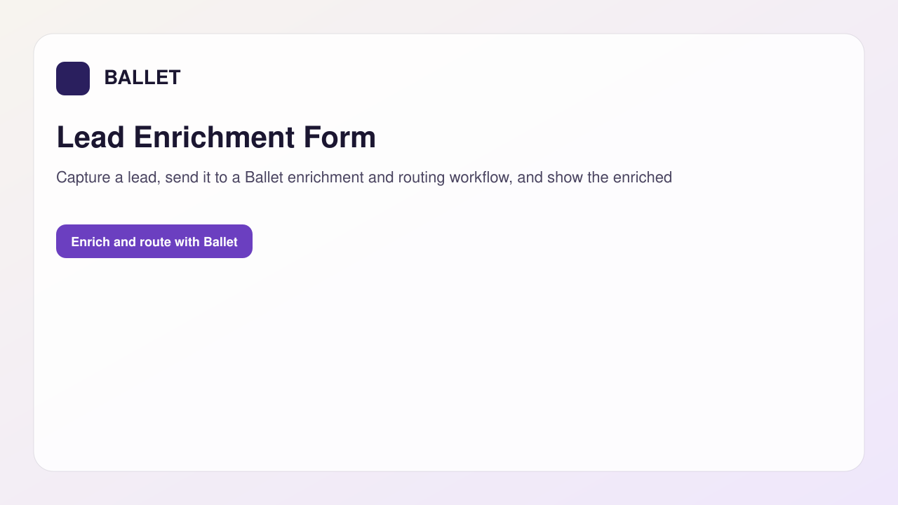

# Lead Enrichment Form

Live streaming generative UI demo: submit a lead, watch Ballet enrich it step by step, then see person, company, ICP fit, and an opener you can copy.



This starter is a backlink and acquisition asset for [Ballet](https://ballet.dev). The Ballet hook is the primary CTA on the page.

## Matching Ballet playbook

Import [salesforce-lead-enrichment](https://github.com/brainfish-ai/ballet-templates/tree/main/templates/salesforce-lead-enrichment):

[](https://app.ballet.dev/import?repo=brainfish-ai/ballet-templates&path=templates/salesforce-lead-enrichment&ref=main)

Alternative for form/webhook scoring: [inbound-lead-slack-alert](https://github.com/brainfish-ai/ballet-templates/tree/main/templates/inbound-lead-slack-alert) ([Import](https://app.ballet.dev/import?repo=brainfish-ai/ballet-templates&path=templates/inbound-lead-slack-alert&ref=main)).

## How the demo works

1. The form posts through `app/api/ballet/route.ts`.
2. That route proxies Ballet's public demo SSE (`NEXT_PUBLIC_BALLET_DEMO_URL`, default `https://ballet.dev/api/demo/enrich`) into an AI SDK UI message stream (`createUIMessageStream`).
3. The client uses `useChat` to render live step cards, the rich result, and promo cards.
4. After one free live (or sample) run, the form locks and points you to Import / Sign up.
5. If the demo endpoint is unreachable, the UI falls back to clearly labelled sample data.
6. Optional BYO: set `BALLET_API_KEY` + `BALLET_WORKFLOW_URL` to hit your own published playbook instead.

## Setup in 3 steps

1. Create the workflow in Ballet by importing `salesforce-lead-enrichment`, publish it, and copy the REST execute URL (or webhook URL).
2. Copy `.env.example` to `.env.local`. Leave env empty for the public demo / sample fallback, or set `BALLET_API_KEY` plus `BALLET_WORKFLOW_URL` for BYO.
3. Run `npm install && npm run dev`, or deploy to Vercel.

## Deploy

[](https://vercel.com/new/clone?repository-url=https://github.com/brainfish-ai/ballet-templates&root-directory=starters/lead-enrichment-form&env=BALLET_API_KEY,BALLET_WORKFLOW_URL,NEXT_PUBLIC_BALLET_DEMO_URL)

[](https://v0.dev/chat/api/open?url=https%3A%2F%2Fraw.githubusercontent.com%2Fbrainfish-ai%2Fballet-templates%2Fmain%2Fstarters%2Flead-enrichment-form%2Fr%2Flead-enrichment-form.json)

| Link | URL |
|---|---|
| Deploy with Vercel | https://vercel.com/new/clone?repository-url=https://github.com/brainfish-ai/ballet-templates&root-directory=starters/lead-enrichment-form&env=BALLET_API_KEY,BALLET_WORKFLOW_URL,NEXT_PUBLIC_BALLET_DEMO_URL |
| Open in v0 | https://v0.dev/chat/api/open?url=https%3A%2F%2Fraw.githubusercontent.com%2Fbrainfish-ai%2Fballet-templates%2Fmain%2Fstarters%2Flead-enrichment-form%2Fr%2Flead-enrichment-form.json |
| Import playbook | https://app.ballet.dev/import?repo=brainfish-ai/ballet-templates&path=templates/salesforce-lead-enrichment&ref=main |
| Sign up free | https://app.ballet.dev/signup?utm_source=v0&utm_medium=template&utm_campaign=lead-enrichment |
| Ballet docs (auth) | https://ballet.dev/docs/articles/how-do-i-authenticate-with-the-ballet-api-tWaqCPLyGT |
| Ballet docs (execute) | https://ballet.dev/docs/articles/how-do-i-run-a-playbook-over-the-rest-api-KQIz0apagm |

This folder is self-contained (own `package.json`, lockfile, `LICENSE`, `.env.example`). You can copy it to a repo root and run it as-is.

## Environment

See `.env.example`. Summary:

| Variable | Required | Purpose |
|---|---|---|
| `NEXT_PUBLIC_BALLET_DEMO_URL` / `BALLET_DEMO_URL` | No | Public demo SSE URL (default `https://ballet.dev/api/demo/enrich`) |
| `BALLET_API_KEY` | No | Workspace Bearer token (`mt_live_…`) for BYO |
| `BALLET_WORKFLOW_URL` | No | Published playbook execute / run / webhook URL for BYO |

Never commit real keys. Missing BYO vars keep the public demo / sample path working.

## Ballet API (BYO mode)

```bash
curl -N https://api.ballet.dev/api/playbooks/$PLAYBOOK_ID/execute \
  -H "Authorization: Bearer $BALLET_API_KEY" \
  -H "Content-Type: application/json" \
  -d '{
    "input": {
      "lead_id": "demo-1",
      "company": "Acme Robotics",
      "email": "jordan@acmerobotics.com",
      "title": "Head of RevOps",
      "name": "Jordan Lee",
      "website": "https://acmerobotics.com",
      "message": "Need inbound routing"
    }
  }'
```

| Piece | Value |
|---|---|
| Base host | `https://api.ballet.dev` (not `app.ballet.dev`) |
| Auth header | `Authorization: Bearer <workspace token>` |
| Token shape | `mt_live_…` from Studio → Settings → API tokens |
| Env var in this starter | `BALLET_API_KEY` (same value as docs' `BALLET_API_TOKEN`) |
| Preferred URL | `BALLET_WORKFLOW_URL=https://api.ballet.dev/api/playbooks/<id>/execute` |
| Execute body | `{ "input": { … } }` |
| Execute response | SSE stream; final `run_stop` carries `success` and `output` |
| Webhook URLs | If `BALLET_WORKFLOW_URL` contains `/webhooks/`, the body is the input object (no `{ input }` wrapper) |

## Open in v0

v0 loads apps from a public shadcn registry item JSON via:

`https://v0.dev/chat/api/open?url=<raw-json-url>`

This starter ships `r/lead-enrichment-form.json` for that purpose. Regenerate it with `node scripts/generate-registry.mjs` after editing source files.

## Scripts

```bash
npm install
npm run dev
npm run lint
npm run build
node scripts/generate-registry.mjs
```

## License

MIT. See [LICENSE](./LICENSE).
