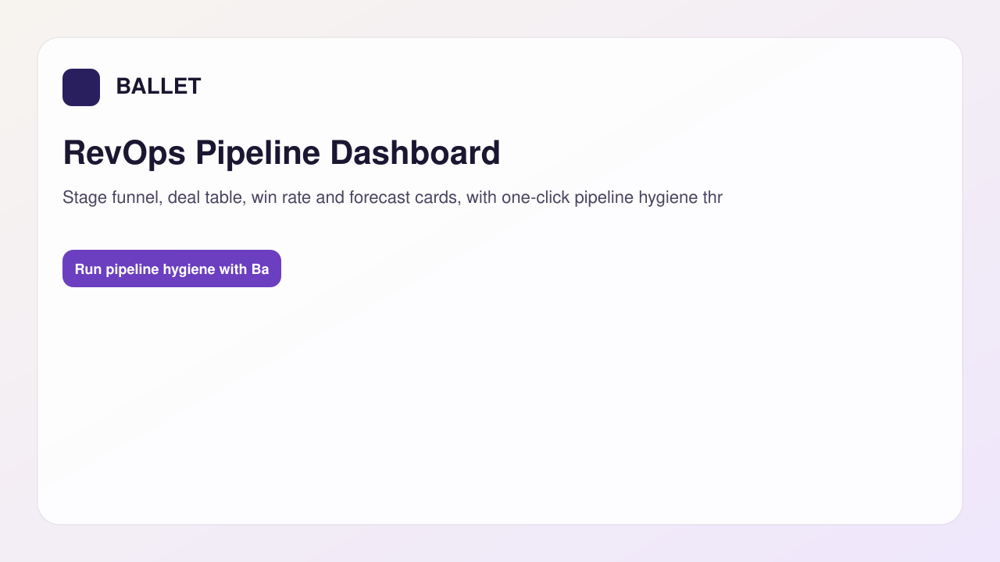

# RevOps Pipeline Dashboard

Stage funnel, deal table, win rate and forecast cards, with one-click pipeline hygiene through Ballet.



This starter is a backlink and acquisition asset for [Ballet](https://ballet.dev). The Ballet hook is the primary CTA on the page.

## Matching Ballet playbook

Import [`crm-hygiene`](../../templates/crm-hygiene) (HubSpot CRM hygiene report):

[Import to Ballet](https://app.ballet.dev/import?repo=brainfish-ai/ballet-templates&path=templates/crm-hygiene&ref=main)

Related templates:
- [`win-loss-by-competitor`](../../templates/win-loss-by-competitor) ([Import](https://app.ballet.dev/import?repo=brainfish-ai/ballet-templates&path=templates/win-loss-by-competitor&ref=main))

## Setup in 3 steps

1. Create the workflow in Ballet by importing `crm-hygiene` (or remix an equivalent playbook), then publish it and copy the webhook URL or REST execute URL.
2. Set env vars in `.env.local` from `.env.example`: `BALLET_API_KEY` (workspace API token) and `BALLET_WORKFLOW_URL`.
3. Deploy to Vercel (or run `npm install && npm run dev` locally). Missing env vars fall back to mock responses so the demo still works.

## Deploy

[](https://vercel.com/new/clone?repository-url=https://github.com/brainfish-ai/ballet-templates&root-directory=starters/revops-pipeline-dashboard&env=BALLET_API_KEY,BALLET_WORKFLOW_URL)

[](https://v0.app/chat/api/open?url=https%3A%2F%2Fraw.githubusercontent.com%2Fbrainfish-ai%2Fballet-templates%2Fmain%2Fstarters%2Frevops-pipeline-dashboard%2FREADME.md)

| Link | URL |
|---|---|
| Deploy with Vercel | https://vercel.com/new/clone?repository-url=https://github.com/brainfish-ai/ballet-templates&root-directory=starters/revops-pipeline-dashboard&env=BALLET_API_KEY,BALLET_WORKFLOW_URL |
| Open in v0 | https://v0.app/chat/api/open?url=https%3A%2F%2Fraw.githubusercontent.com%2Fbrainfish-ai%2Fballet-templates%2Fmain%2Fstarters%2Frevops-pipeline-dashboard%2FREADME.md |

## Ballet API notes

The route at `app/api/ballet/route.ts` POSTs to `BALLET_WORKFLOW_URL` with `Authorization: Bearer $BALLET_API_KEY`.

- Execute URLs receive `{ "input": { ... } }` and may stream SSE (`run_stop` carries the output).
- Webhook URLs (path contains `/webhooks/`) receive the event payload directly.

Never commit real keys.

## Scripts

```bash
npm install
npm run dev
npm run lint
npm run build
```
